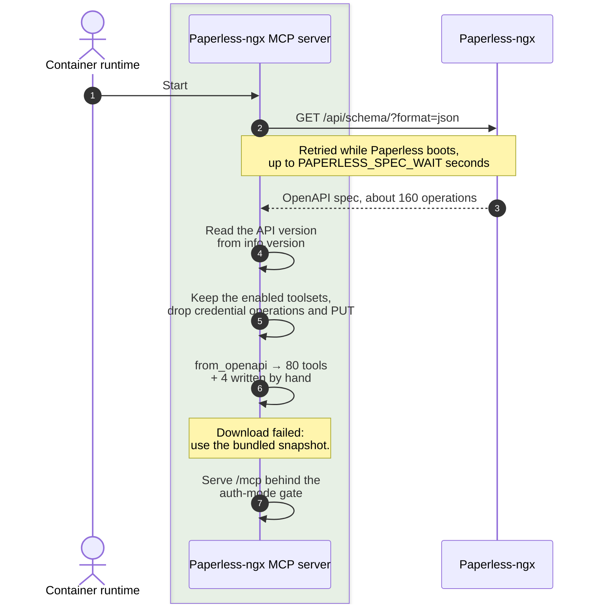
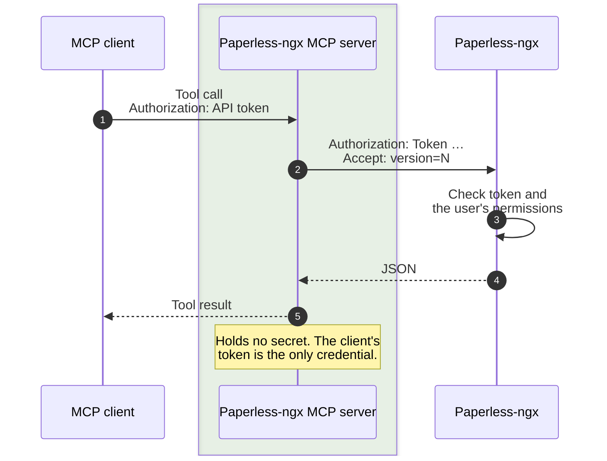
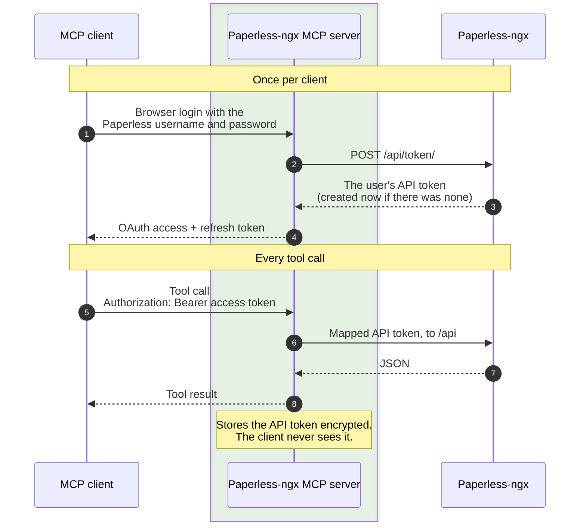

---
hide:
  - toc
---

# How it works

The Paperless-ngx MCP server downloads the OpenAPI spec from your Paperless-ngx, turns its operations into MCP tools, and forwards each call to Paperless with an API token: either the one the client sent, or, with OAuth, the one it fetched for that user at login.

```mermaid
--8<-- "docs/diagrams/architecture.mmd"
```

The Paperless-ngx MCP server runs as a container sidecar and talks to Paperless over the internal Docker network. Clients reach it through a TLS-terminating reverse proxy or directly over a trusted LAN.

## Tools from the OpenAPI spec

At startup the server downloads the spec from `PAPERLESS_URL/api/schema/`, trims it, and generates one tool per remaining operation with `FastMCP.from_openapi`.



The trimming is what makes the result usable:

- **Toolsets.** Only the operations under the enabled path prefixes are kept, see [Tools](tools.md#toolsets).
- **Never tools.** Operations that mint or replace the API token, or change how the account logs in, are dropped in every configuration.
- **`PUT` next to `PATCH`** is dropped: the partial update does the same job.
- **Small repairs.** Request bodies are reduced to JSON, the `fields` parameter is sent comma-separated, and a stray query `id` on the notes endpoints is removed, because the spec taken literally produces requests Paperless can't read.
- **Output schemas are cleared.** Paperless answers with objects, bare arrays, strings and empty bodies; a declared schema would make strict clients reject calls that succeeded.

Four operations need real code and are replaced by hand-written tools of the same name: the multipart upload (`documents_post_document_create`) and the three that return a file (`documents_download_retrieve`, `documents_preview_retrieve`, `documents_thumb_retrieve`).

## API token

The client's token passes through unchanged. The Paperless-ngx MCP server stores nothing.



??? note "In detail: tool call in token mode"

    The middleware rejects any request without an `Authorization` header. The token is carried per request, in a context variable, from the middleware to the outgoing API call, where whatever prefix the client used (`Bearer`, `Token`, or none) is replaced by the `Token` scheme Paperless expects.

    ```mermaid
    sequenceDiagram
      autonumber
      participant C as MCP client
      box rgba(76, 165, 62, 0.1) Paperless-ngx MCP server
        participant MW as TokenCapture<br>Middleware
        participant F as FastMCP<br>tools
        participant H as httpx2 +<br>PaperlessTokenAuth
      end
      participant P as Paperless-ngx
      Note over C,P: Missing token
      C->>MW: POST /mcp, no Authorization
      MW-->>C: 401 WWW-Authenticate: Bearer
      Note over C,P: Tool call
      C->>MW: POST /mcp<br>Authorization: token
      MW->>MW: Stash token in<br>_incoming_auth
      MW->>F: Forward request
      F->>H: Call the mapped<br>API operation
      H->>H: Read token,<br>strip its prefix
      H->>P: /api/…<br>Authorization: Token …
      P->>P: Validate token
      P-->>H: JSON
      H-->>F: Response
      F-->>MW: Tool result
      MW->>MW: Reset context variable
      MW-->>C: Tool result
    ```

## OAuth

A one-time browser login fetches the user's API token. After that, the client only holds opaque OAuth tokens that map to it. The OAuth machinery (discovery, registration, login page, token store) comes from the shared [mcp-login-oauth](https://github.com/Marceltov/mcp-login-oauth) library; this server supplies the login fields and the Paperless check.



??? note "In detail: login (discovery, registration, credentials, code exchange)"

    The client discovers the OAuth endpoints from the `401`, registers itself, and sends the user to the login page. The credentials are exchanged once for the user's API token; the client only ever holds opaque `pmcp_` tokens that map to it.

    ```mermaid
    sequenceDiagram
      autonumber
      actor U as User
      participant C as MCP client
      box rgba(76, 165, 62, 0.1) Paperless-ngx MCP server
        participant A as OAuth<br>provider
        participant S as mcp-oauth<br>store
      end
      participant P as Paperless-ngx
      Note over U,P: Discovery and registration
      C->>A: POST /mcp, no token
      A-->>C: 401 with resource metadata
      C->>A: GET /.well-known/…<br>POST /register
      A->>S: Save client
      A-->>C: client_id
      Note over U,P: Login
      C->>A: GET /authorize (PKCE)
      A->>S: Pending login, 10 min
      A-->>U: Redirect to /login
      U->>A: POST /login<br>username, password, 2FA code
      A->>P: POST /api/token/
      P-->>A: API token
      Note over A: The password is used once,<br>never stored or logged.
      A->>S: Auth code → API token
      A-->>C: Redirect with code
      Note over U,P: Code exchange
      C->>A: POST /token<br>code + verifier
      A->>S: pmcp_ tokens → API token
      A-->>C: Access token (1 h)<br>refresh token (30 d)
    ```

    An account that signs in to Paperless through single sign-on has no password to exchange. It pastes its API token into the login page instead, and the server checks it against `GET /api/profile/` before issuing anything.

??? note "In detail: tool call in oauth or both mode"

    `verify_token` maps a `pmcp_` token to its API token. In `both` mode any other token is passed through as a raw API token, and an expired `pmcp_` token gets a `401` so the client refreshes.

    ```mermaid
    sequenceDiagram
      autonumber
      participant C as MCP client
      box rgba(76, 165, 62, 0.1) Paperless-ngx MCP server
        participant F as FastMCP<br>auth + tools
        participant A as verify_token
        participant H as httpx2 +<br>PaperlessTokenAuth
      end
      participant P as Paperless-ngx
      C->>F: POST /mcp<br>Bearer pmcp_ token or raw API token
      Note over F: both mode: a raw or "Token …" header<br>is rewritten to "Bearer …" first
      F->>A: verify_token(token)
      A->>A: Look up in the<br>mcp-oauth store
      alt Issued by us (pmcp_)
        A-->>F: grant = mapped token
      else Not ours, both mode
        A-->>F: grant = the raw token
      else Expired or revoked, or oauth mode
        A-->>F: None
        F-->>C: 401, client refreshes or logs in
      end
      F->>H: Call the mapped<br>API operation
      H->>H: Read the grant<br>from the access token
      H->>P: /api/…<br>Authorization: Token …
      P-->>H: JSON
      H-->>F: Response
      F-->>C: Tool result
    ```

??? note "In detail: refresh and revoke"

    Refreshing rotates the OAuth token pair onto the same API token. Revoking drops the pair and nothing else: Paperless has [one API token per user](security.md#one-api-token-per-user), shared by all of that user's clients, so it is left alone.

    ```mermaid
    sequenceDiagram
      autonumber
      participant C as MCP client
      box rgba(76, 165, 62, 0.1) Paperless-ngx MCP server
        participant A as OAuth<br>provider
        participant S as mcp-oauth<br>store
      end
      Note over C,S: Refresh, when the access token expires
      C->>A: POST /token<br>grant_type=refresh_token
      A->>S: Drop the old pair
      A->>S: New pmcp_ pair → same API token
      A-->>C: New access + refresh token
      Note over C,S: Revoke, to disconnect this client
      C->>A: POST /revoke
      A->>S: Drop the pair
      Note over S: The API token in Paperless<br>is not touched.
    ```

## Startup errors and health

If the auth configuration is invalid, or a pinned spec can't be loaded, the server serves a `startup_error`-only tool list instead of crashing, so the client shows the reason. `GET /health` always answers `200 ok` without authentication, for the container healthcheck.
